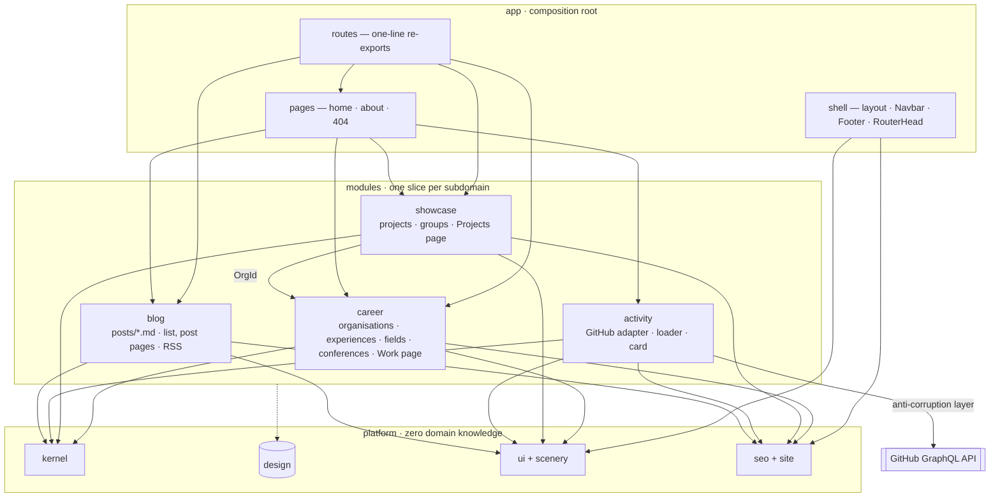
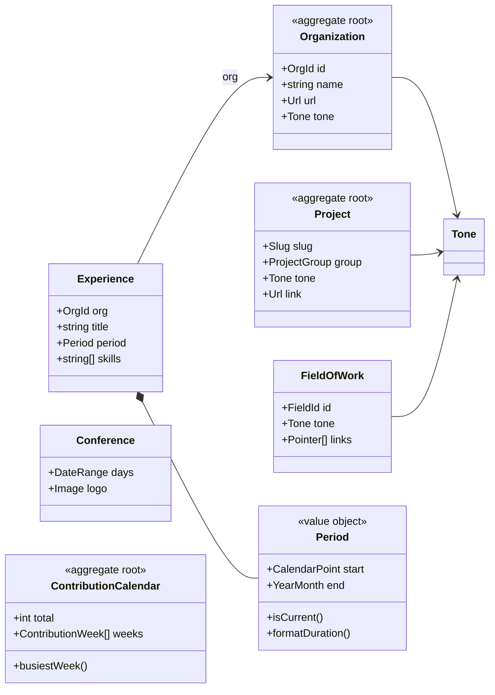

# Architecture

A fully static site: every page is rendered while the site is built, and a daily rebuild keeps the
dates, the conferences and the GitHub card current. The code is organised around **what the site is
about** (its subdomains), not around file types, so that anything about one subject changes in one
folder — and a new subject, such as the blog, is one new folder plus two registration lines.

## The three layers

```
src/
  app/        the composition root — the only place where modules meet
  modules/    one vertical slice per subdomain: model, content, queries, UI, page, tests
  platform/   stable shared ground with zero domain knowledge
```

| Layer       | Contains                                                                                                                                                                                                                                                                                               | May import                                             |
| ----------- | ------------------------------------------------------------------------------------------------------------------------------------------------------------------------------------------------------------------------------------------------------------------------------------------------------ | ------------------------------------------------------ |
| `platform/` | `kernel` (value objects and pure functions: dates, `Period`, `Tone`, Valibot building blocks), `design` (tokens, the tone context, motion, utilities), `ui` (Button, Chip, PageHeader, ClosingScene, icons…), `scenery` (hills, clouds, the hero drawings), `seo` (site identity, `pageHead`), `build` | only itself                                            |
| `modules/`  | `career`, `showcase`, `activity` — and later `blog`                                                                                                                                                                                                                                                    | `platform`; other modules **only** via `~/modules/<x>` |
| `app/`      | `routes` (a manifest of one-line re-exports), `pages` (home, about, 404: compositions of several modules), `shell` (layout, navbar, footer, head)                                                                                                                                                      | everything, through public APIs                        |

These rules are enforced by ESLint (`no-restricted-imports` in `eslint.config.js`), not by discipline.
`src/root.tsx` and `src/entry.ssr.tsx` stay at the top level because Qwik looks for them there.



## Anatomy of a module

Every module follows the same template, so you always know where to look:

```
modules/<name>/
  index.ts        public API — the only path other code may import
  model.ts        Valibot schemas + inferred types. The domain's rules live here
  content/        the records themselves, checked against the model during the build
  queries.ts      pure functions over the content (tested)
  adapter.ts      only when the outside world is involved (activity: GitHub)
  loader.ts       only when a page needs build-time data (re-exported by the route)
  ui/             the module's components, built from platform primitives
  pages/          the page(s) the module owns, with their `head`
  <name>.test.ts
```

**Content is validated while the site is built.** Each `content/index.ts` runs its schemas under
`import.meta.env.SSR`, so a mistyped date or link fails the build rather than the page. The browser
never sees Valibot.

**Routes are a manifest.** `src/app/routes/work/index.tsx` is one line:
`export { WorkPage as default, workHead as head } from "~/modules/career";`. Qwik City runs a
`routeLoader$` declared in a module as long as the route re-exports it (see `modules/activity/loader.ts`).
The same works for `onGet`, `onStaticGenerate` and a function `head` (see `modules/blog/pages`).

## The domain model



`Organization` is the registry everything else points at by id: an experience, a hero fact or an
affiliation row carries an `OrgId`, and its name, URL and tone are looked up. Anything that can be
derived is derived — the "Right now" tile and the climate field's "since Dec 2025" come from the
current role, the project count from the projects.

## Where do I change…?

| Change                                  | Touch                                                |
| --------------------------------------- | ---------------------------------------------------- |
| A job, a conference, an organisation    | `modules/career/content/`                            |
| A project                               | `modules/showcase/content/projects.ts`               |
| The GitHub card's text or chart         | `modules/activity/ui/`                               |
| The hero or the home page's tiles       | `app/pages/home/`                                    |
| Colours, radii, shadows, motion         | `platform/design/`                                   |
| A shared button, chip or heading        | `platform/ui/`                                       |
| The site's URL, name, nav, social links | `platform/seo/site.ts`                               |
| Meta tags and the link-preview card     | `platform/seo/page-head.ts`                          |
| A new subdomain (the blog, talks, …)    | new `modules/<x>/` + its route lines + one nav entry |

## Design system

The visual language lives in `platform/design`:

- **Tokens** (`theme.css`): the only palette, fonts, radii and shadows. `--color-*: initial` makes
  sure nothing off-brand slips in.
- **Tones**: each organisation, field and project carries one of five tones so it reads as the same
  thing everywhere. A tone is applied once with `data-tone="teal"`; everything inside then uses
  `bg-tone`, `text-tone-ink` and `bg-tone-tint`. Without a tone they fall back to ink on a panel.
- **Motion** (`motion.css`): every animation token and its keyframes, always used through
  `motion-safe:`.
- **Utilities** (`utilities.css`): the page column (`wrap`), the skies, the sun glows and the
  `live-dot`.

Components in `platform/ui` are plain functions when they have no state (icons, Button, Chip) and
`component$` only when they need state, tasks or a `Slot` (PageHeader, ClosingScene, Navbar).

## Build and deploy

- `bun run build` runs the client build, the type check, the lint and the static build, in that
  order. The static adapter renders every route to `dist/`, with a sitemap and a `404.html`.
- `platform/build/fresh-image-cache.ts` clears vite-imagetools' cache before each build: restored
  images re-encode with a different hash, which would leave the SSR HTML pointing at files the
  client build never emitted.
- The GitHub card is fetched during the build with `GITHUB_TOKEN`; without it the card links to the
  profile and leaves out the chart.
- Dates are formatted by hand (`platform/kernel/dates.ts`) rather than with `Intl`, so the output
  doesn't depend on the ICU data of whichever runtime builds the site.

## Decisions

| Decision                                              | Why                                                                                                                                                 |
| ----------------------------------------------------- | --------------------------------------------------------------------------------------------------------------------------------------------------- |
| Stay on Qwik City                                     | MDX, frontmatter, headings and SSG are built in; routes-as-manifest and module-owned MDX were verified to work. A migration buys nothing structural |
| Routes are re-exports                                 | File-based routing wants to own pages; the manifest keeps each page's code with its module                                                          |
| Tones as a CSS context (`data-tone`)                  | Removes the class lookup table and prop threading; class names stay static for Tailwind; the blog can tone tags and series the same way             |
| Global CSS inlined into each page                     | One fewer render-blocking request; revisit if the blog multiplies entry pages and measurements favour a cached stylesheet                           |
| Hand-written date formatting                          | Deterministic across runtimes (`Intl` gives "Sept" on some)                                                                                         |
| Valibot at build time, `satisfies` at type-check time | Types come from the schemas; the build catches what types can't (URL and date formats, date order)                                                  |

## Tooling

Bun runs scripts and installs packages; Vite builds (Qwik's optimizer is a Vite plugin); Tailwind
CSS v4 styles with tokens in CSS; TypeScript runs in strict mode with every extra check on;
ESLint's flat config with typed rules and `eslint-plugin-perfectionist` for import order; Prettier
formats; `bun test` runs the unit tests.
