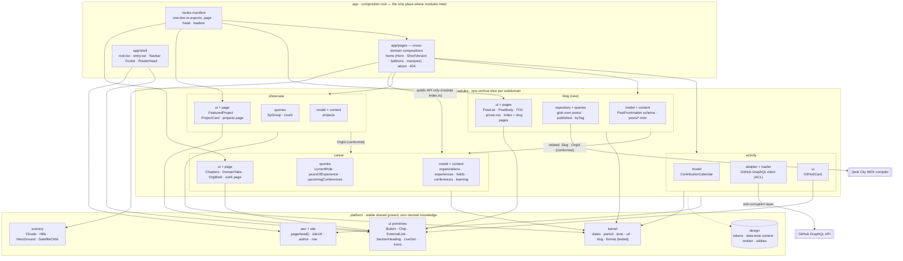
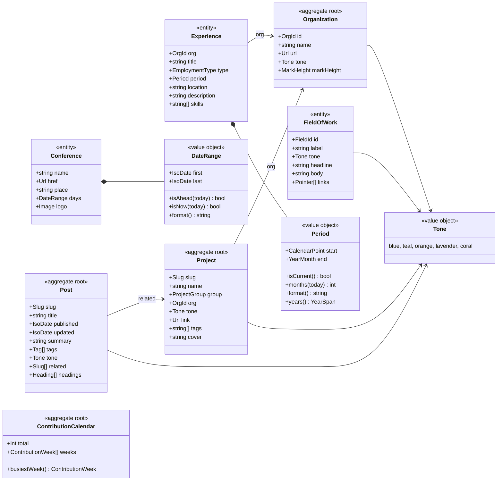

# Cleanup & Architecture Plan (before the blog)

Status: **all phases done**, including the blog (see `BLOG_ROADMAP.md` beside this file).
`docs/ARCHITECTURE.md` now describes the result; this file keeps the findings and the reasoning.

Deviations from the plan as written: `root.tsx` and `entry.ssr.tsx` stayed at `src/` (Qwik's
entry-point convention); the Navbar keeps its Qwik implementation (the Popover API move is still
open); both deploy configurations are still in place pending a decision.

## 0. What the project is today

A fully static Qwik City site (4 pages + 404). All content is TypeScript data. It's rendered at
build time by the static adapter, and a daily cron rebuild keeps dates, the conferences and the GitHub card fresh.

Verified baseline (built on Linux with the installed dependency versions):

| Check                | Result                                                                                                            |
| -------------------- | ----------------------------------------------------------------------------------------------------------------- |
| `tsc --noEmit`       | ✅ clean                                                                                                          |
| `eslint src/**`      | ✅ clean                                                                                                          |
| `prettier --check .` | ❌ 3 files (`docs/*.md`, `wrangler.jsonc`)                                                                        |
| Build (client + SSG) | ✅ 5 pages                                                                                                        |
| Tests                | none exist                                                                                                        |
| Global CSS           | 41 KB inlined into **every** HTML page (`?inline` + `useStyles$`)                                                 |
| Client JS            | Valibot correctly tree-shaken out; portfolio data (~9 KB) is in a client chunk because of SPA `<Link>` navigation |

Overall the code is careful, strictly typed, accessible and well commented. Its problems are
**structural**, not quality problems:

1. **No single source of truth.** Organisation facts (name, URL, tone) live in four places:
   `links`, `experiences`, the `orgs` map inside `routes/index.tsx`, and the hard-coded prose.
2. **Mixed responsibilities.** `data/portfolio.ts` (566 lines) holds schemas, content, validation
   and a date/formatting library. `routes/index.tsx` (416 lines) holds data tables plus five sections.
3. **No design-system layer.** Buttons, chips, section titles, external links and "live" dots are
   copy-pasted Tailwind strings. Tones are threaded manually through 12 `toneClasses[...]` lookups.
4. **Project-level drift.** There are two deploy targets, a misleading `preview`, docs that don't match the code,
   and no tests or PR checks.

---

## 1. Findings

### 1.1 Dead code / dead config

| Item                                                                                                                                                                                                                                                                                                                                     | Where                                   | Action                                                                                                          |
| ---------------------------------------------------------------------------------------------------------------------------------------------------------------------------------------------------------------------------------------------------------------------------------------------------------------------------------------- | --------------------------------------- | --------------------------------------------------------------------------------------------------------------- |
| Two competing deploy pipelines for the same domain: Cloudflare Workers (`wrangler.jsonc`, `.wrangler` in gitignore) **and** GitHub Pages (`deploy.yml`, `public/CNAME`). Docs mention only Pages. Workers Builds has no daily rebuild, so its dates would go stale. `wrangler` isn't a dependency, and its `$schema` path doesn't exist. | root                                    | **Decide one**, delete the other                                                                                |
| `serverData: { ...opts.serverData }` is a no-op spread                                                                                                                                                                                                                                                                                   | `entry.ssr.tsx`                         | delete                                                                                                          |
| `lang="en"` is set on both `<html>` (containerAttributes) and `<body>`                                                                                                                                                                                                                                                                   | `root.tsx`                              | keep on `<html>` only                                                                                           |
| Stale comment about `head.styles/scripts`                                                                                                                                                                                                                                                                                                | `router-head.tsx`                       | rewrite                                                                                                         |
| `keywords` meta (search engines ignore it)                                                                                                                                                                                                                                                                                               | `page-head.ts`                          | delete                                                                                                          |
| `twitter:title/description/image/image:alt` duplicate OG (X falls back to OG)                                                                                                                                                                                                                                                            | `page-head.ts`                          | keep `twitter:card` only                                                                                        |
| `"plugins": []`                                                                                                                                                                                                                                                                                                                          | `.prettierrc`                           | delete                                                                                                          |
| `typecheck` duplicates `build.types` (`qwik build` already runs `build.types` + `lint`)                                                                                                                                                                                                                                                  | `package.json`                          | keep one                                                                                                        |
| `dev.debug` (rarely useful, Bun-specific inspect flags)                                                                                                                                                                                                                                                                                  | `package.json`                          | delete                                                                                                          |
| `preview` + `build.preview` + `entry.preview.tsx`: this SSR-renders pages on the fly rather than serving the `dist/` that ships, so it doesn't preview the static output (404 handling, trailing slashes)                                                                                                                                | `package.json`, `src/entry.preview.tsx` | replace with a static server over `dist/` (or `wrangler dev` if Cloudflare wins) and delete `entry.preview.tsx` |
| `.playwright-mcp/` console logs from a browser session                                                                                                                                                                                                                                                                                   | root                                    | delete + gitignore                                                                                              |
| Exports only used inside their own file (`careerStart`, `Project`, `Domain`, `Skill`, `Education`, `Certification`, `Conference`, `ContributionWeek`)                                                                                                                                                                                    | data                                    | un-export or move with the split                                                                                |
| `clean` script misses `node_modules/.cache/imagetools`                                                                                                                                                                                                                                                                                   | `package.json`                          | add                                                                                                             |

### 1.2 Duplication

| Duplication                                                                                                                     | Count                 |
| ------------------------------------------------------------------------------------------------------------------------------- | --------------------- |
| `target="_blank" rel="noopener noreferrer"`                                                                                     | 13                    |
| `toneClasses[...]` lookups                                                                                                      | 12                    |
| Section `<h2>` style `text-[clamp(36px,4.4vw,56px)] leading-none tracking-[-0.02em]`                                            | 4                     |
| "Live" green dot with hard-coded `rgb(62_141_83/0.18)` ring                                                                     | 3 (+1 teal variant)   |
| Sun button / panel button class strings                                                                                         | 2 + 2                 |
| Tag chip `rounded-full bg-wash/16 px-3 py-1.5 text-[13px]`                                                                      | 2 (+2 near-identical) |
| Page `<h1>` style: `PageHeader` vs About's hand-rolled header                                                                   | 2                     |
| Portrait alt text                                                                                                               | 2                     |
| Navbar page-link rendering (desktop and mobile)                                                                                 | 2                     |
| Footer social links (same markup twice)                                                                                         | 2                     |
| `"Ahmed Elghareeb"` literal                                                                                                     | 11                    |
| `https://elghareeb.space` (`page-head.ts`, static adapter, `robots.txt`, `CNAME`)                                               | 4                     |
| Token colours re-typed as hex/rgb in `global.css` (`sky-afternoon`, `sun-glow*`, `live` keyframes) and `root.tsx` `theme-color` | 6+                    |
| Org data: `links` ↔ `orgs` ↔ `experiences[].companyUrl/tone` ↔ `domains[].links`                                                | 4 sources             |

### 1.3 Content drift (values that should be derived)

- "Right now: **Resilio**" tile and "Staff Software Engineer, **since Dec 2025**" domain note are hard-coded
  copies of the current experience.
- Projects intro "Three of these **four**…" will be wrong when a project is added, while the home tile already
  derives `projects.length`.
- "The identity trilogy" section is selected by `featured: false`, which couples a heading to a boolean.
- `experiences` for C4DT and Back Market have **no `companyUrl`**, although the URLs exist in `orgs`. As a result the
  Work page shows them unlinked.
- Featured project section id is built from `cover` (`featured-.ts` is possible), so use a slug.
- Marquee tones are decorative cycling, which contradicts the documented rule "one tone per org/domain".
- The tile's live-dot ring hard-codes teal whatever the tile tone.
- (Content check for you: C4DT is "Full-time" until 2026-04 and Resilio "Full-time" from 2025-12. The two overlap.)

### 1.4 Best-practice gaps

- **No tests**, although the date maths (inclusive vs. completed months, UTC turnover) is exactly the subtle
  logic that needs them. `bun test` adds zero dependencies.
- **CI only runs on push to `main`.** There are no PR checks and `fmt.check` never runs.
- **Canonical URL from `useLocation()`**: the 404 page emits `canonical = /404.html`. The canonical should come
  from the page's own head definition, and the 404 page should have none.
- **`component$` for static, prop-only pieces** (7 icons, Hills, Clouds, OrgMark, SkillsMarquee): HeroScene already uses
  plain inline components for the same kind of thing, so the convention is inconsistent.
- **`useOnDocument("click")` in Navbar** registers a document-wide listener on every page, so the first click anywhere
  lazy-loads that chunk. The native Popover API (`popover` + `popovertarget`) gives light-dismiss,
  Esc-to-close and `aria-expanded` for free, which matches the "native web features" philosophy.
- **Magic layout coupling**: the hero's `calc(100svh-58px)` depends on header height, so a `--header-h` custom property would replace it.
- **Docs**: `ARCHITECTURE.md` argues for tool choices but doesn't describe the architecture (build-time
  content → SSG, design tokens, tones, scenes, daily rebuild). The `DEVELOPMENT.md` tree is outdated.

### 1.5 Things that look odd but should **stay**

- `freshImageCache` Vite plugin: a real fix for non-deterministic imagetools caching between the client and SSR builds.
- Hand-written date formatting. `Intl.DateTimeFormat.formatRange` reproduces `formatDays` exactly, **but**
  output depends on the runtime's ICU/CLDR (`en-GB` now yields "Sept"), and production builds on Bun/JSC.
  The hand-written version is deterministic, so keep it, move it and test it.
- Self-hosted font subsets with `unicode-range` for "→": deliberate and good.
- Inline conference-expiry `<script>`: a tiny guard if the cron stops, cheaper than any Qwik task.
- Valibot validation at build time with `satisfies`: a good pattern that the blog frontmatter should reuse.
- Qwik itself (see §4).

---

## 2. Target architecture: a modular monolith around the subdomains

**Goal (restated):** all code for one subdomain changes in exactly one folder. Adding the blog — or any
future section (talks, reading list, /uses …) — means adding one module and touching two known
registration points, nothing else.

The shape that delivers this is **vertical slices over a thin, stable platform**:

- `modules/<subdomain>/` owns _everything_ about that subdomain: schemas and invariants, the content
  itself, queries, any adapter to the outside world, its UI components, its page(s) with loaders and
  head, and its tests.
- `platform/` is the stable ground modules stand on: the shared kernel (value objects), the design
  system, UI primitives, the scenery drawings and SEO. It contains **no domain knowledge** and changes rarely.
- `app/` is the composition root and the **only** place where modules meet: the route manifest, the
  cross-domain pages (home, about, 404) and the site shell.

### 2.1 Feasibility — verified, not assumed

The usual blocker for vertical slices is file-based routing, which wants to own the pages. I tested the
three escape hatches against this exact codebase (real builds in a sandbox):

| Requirement                                                   | Result                                                                                                                        |
| ------------------------------------------------------------- | ----------------------------------------------------------------------------------------------------------------------------- |
| A route file can be a one-line re-export of a module's page   | ✅ `routeLoader$` declared in `src/modules/blog/loader.ts`, re-exported from the route — SSG output correct                   |
| MDX posts can live **inside the module**, not under `routes/` | ✅ `src/modules/blog/posts/hello/index.mdx` compiled when imported: body renders, `frontmatter` and `headings` exports intact |
| The routes folder can move under `app/` if we want            | ✅ `qwikCity({ routesDir })` is a supported option                                                                            |

So **no framework change is needed** to reach the ideal (see §2.8 for the explicit framework decision).

### 2.2 Ubiquitous language and bounded contexts

One module per bounded context. A module may own pages (work → career, projects → showcase, blog → blog);
pages that compose several contexts (home, about) live in `app/pages` and may only use module public APIs.

| Module (bounded context) | Meaning                                     | Aggregate roots / entities                                                                                                           | Owns the page(s)          |
| ------------------------ | ------------------------------------------- | ------------------------------------------------------------------------------------------------------------------------------------ | ------------------------- |
| **career**               | Where Ahmed has worked and what he works on | `Organization` (root), `Experience`, `FieldOfWork` (today's "domain" tabs), `Conference`, `Education`, `Certification`, `SkillGroup` | `/work/`                  |
| **showcase**             | Open-source work                            | `Project` (root) with a `ProjectGroup` (`featured`, `identity`, …)                                                                   | `/projects/`              |
| **blog**                 | Writing                                     | `Post` (root) = frontmatter + MDX body + headings; `Tag`, `Series`                                                                   | `/blog/`, `/blog/[slug]/` |
| **activity**             | Public GitHub contributions                 | `ContributionCalendar` (root), `ContributionWeek`                                                                                    | — (a card on home)        |
| platform **kernel**      | Value objects every module uses             | `IsoDate`, `YearMonth`, `Period`, `DateRange`, `Tone`, `Url`, `Slug`, `plural()`                                                     | —                         |
| platform **site**        | Identity of the website itself              | `siteUrl`, author, navigation, social links                                                                                          | —                         |

Today's vocabulary drifts ("domain" means both a field of work and a DNS name; `featured` means "the one
big card"; `links` is half a registry). Renaming to this table is part of the refactor.

### 2.3 Component diagram



Dependency rules (enforced with ESLint `no-restricted-imports` / `eslint-plugin-boundaries`, not by discipline):

1. `platform` imports nothing above it. It never knows a module exists.
2. A module imports `platform` freely, and **another module only through its public API** (`~/modules/career`),
   and only for identity types — here that is showcase/blog referring to `OrgId`/`Slug`. Deep imports
   (`~/modules/career/content/…`) are lint errors everywhere outside the module.
3. `app` may import every module's public API; nothing imports `app`.
4. `routes/` contains **no logic** — re-export lines only. A diff touching `routes/` plus more than one
   module is a code-review red flag.

### 2.4 Anatomy of a module (the template every slice follows)

```
modules/<name>/
  index.ts          # public API — the only path other code may import
  model.ts          # Valibot schemas + inferred types + invariants (domain rules live here)
  content.ts        # the records themselves   (blog: posts/<slug>/index.mdx instead)
  queries.ts        # pure functions over content — no Qwik imports, bun-tested
  adapter.ts        # only when the outside world is involved (activity: GitHub; blog: MDX glob)
  ui/               # the module's components; built from platform primitives + tokens
  pages/            # page component(s) + routeLoader$ + head for routes this module owns
  <name>.test.ts
```

Definition of done for a slice: content edits for the subdomain touch only this folder; `queries.ts` has
tests; `model.ts` validation runs in `validateContent()`; no deep imports in or out; the route file for its
page is one line.

### 2.5 Domain model

(unchanged by the restructuring — the model below is simply distributed into the modules' `model.ts` files)



Notes on the model:

- `Organization` becomes the root that `Experience`, hero facts, org rows and `Project` point to by `OrgId`.
  That collapses today's four copies of the same facts, and a missing logo for a registered organisation becomes
  a type error in `OrgMark`.
- `Period` and `DateRange` take over the functions at the end of `portfolio.ts` (`formatPeriod`,
  `formatDuration`, `experienceYears`, `formatDays`, the "today" checks). The behaviour stays identical, but it gets
  a name, a home and tests. They stay plain objects plus functions, not classes, so Qwik can serialise them.
- `Tone` stays a value object with five values. The rule "one tone per organisation or field" is then enforceable,
  because an experience no longer carries its own tone.
- `Post` is the blog's root: frontmatter fields are validated by the same schema machinery, `headings` come
  from the MDX compiler, and `related` lets a post point at a project or a field of work.

### 2.6 Proposed tree

```
src/
  app/
    routes/                        # manifest only (Qwik City routesDir): each file re-exports from a module
      index.tsx                    #   export { default, head, useGitHubActivity } from "~/app/pages/home"
      work/index.tsx               #   export { default, head } from "~/modules/career/pages/work"
      projects/index.tsx           #   export { default, head } from "~/modules/showcase/pages/projects"
      blog/index.tsx  blog/[slug]/index.tsx
      about/index.tsx  404.tsx  layout.tsx
    pages/                         # cross-domain compositions (the only consumers of several modules)
      home/   Hero  ShortVersion  SkillsMarquee  (+ loader wiring for activity)
      about/  404/
    shell/                         # root.tsx  entry.ssr.tsx  Navbar  Footer  RouterHead  site layout
  modules/
    career/     index.ts  model.ts  content/(organizations experiences fields conferences learning skills)
                queries.ts  ui/(Chapters DomainTabs OrgMark ConferenceBalloons)  pages/work.tsx  tests
    showcase/   index.ts  model.ts  content/projects.ts  queries.ts  ui/  pages/projects.tsx  tests
    blog/       index.ts  model.ts  posts/<slug>/index.mdx  repository.ts  queries.ts
                ui/(PostList PostCard PostBody TableOfContents prose.css)  pages/(index.tsx [slug].tsx)  tests
    activity/   index.ts  model.ts  adapter.ts (GitHub GraphQL, ACL)  loader.ts  queries.ts  ui/GitHubCard  tests
  platform/
    kernel/     dates  period  date-range  tone  url  slug  format   (+ tests)
    design/     global.css → fonts  theme (tokens + data-tone)  motion  utilities
    ui/         Button  Chip  ExternalLink  SectionHeading  LiveDot  PageHeader  ClosingScene  icons
    scenery/    Clouds  Hills  HeroGround  SatelliteOrbit
    seo/        page-head.ts  site.ts
    build/      validate-content.ts  fresh-image-cache.ts
  media/
```

### 2.7 Key pattern changes

**a) Organisation registry (single source of truth)**

```ts
// modules/career/content/organizations.ts
export const organizations = {
  resilio:    { name: "Resilio", url: "https://resilio.tech", tone: "teal", markHeight: "h-[1em]" },
  c4dt:       { name: "C4DT",    url: "https://c4dt.epfl.ch", tone: "blue", markHeight: "h-[0.8em]" },
  backMarket: { name: "Back Market", url: "https://www.backmarket.com", tone: "orange", … },
  …
} as const satisfies Record<string, Organization>;
export type OrgId = keyof typeof organizations;
```

Experiences, hero facts, org rows and domain links then reference `OrgId`. `OrgMark`'s `Org` type becomes
`OrgId`, so a logo missing for a registered org is a type error.

**b) Tone as a CSS context instead of a class lookup table**

```css
/* theme.css */
[data-tone="teal"] {
  --tone: var(--color-teal);
  --tone-ink: var(--color-teal-ink);
  --tone-tint: var(--color-teal-tint);
}
/* …one line per tone… */
@theme inline {
  --color-tone: var(--tone);
  --color-tone-ink: var(--tone-ink);
  --color-tone-tint: var(--tone-tint);
}
```

```tsx
<li data-tone={group.tone} class="bg-tone-tint …">
  <h3 class="text-tone-ink">…</h3>
</li>
```

This removes `toneClasses` and the 12 lookups. Children inherit the tone without prop threading, class names stay
static (so Tailwind can scan them), and the live-dot ring becomes `color-mix(in srgb, var(--tone) 20%, transparent)`,
which fixes the hard-coded teal. The blog can tone a post or series with one attribute.

**c) UI primitives for repeated patterns** (no new dependency, just a small variant map)

- `Button` with `variant: "sun" | "panel" | "ink" | "dusk"`, which renders `<Link>` for internal hrefs and
  `ExternalLink` for external ones (the DomainTabs logic, generalised).
- `ExternalLink`: owns `target`/`rel` (13 call sites).
- `SectionHeading`, `Chip`, `LiveDot`, and `PageHeader` with an optional aside so About can use it too.
- `icons.tsx`: one module of inline components sharing a base `<svg>` (consistent sizing and stroke).

**d) Derive instead of duplicate**

`currentRole = experiences.find(e => e.end === null)`. This drives the "Right now" tile, the domain note "since Dec 2025"
and the hero sentence. The projects intro count is derived from the projects, and the sections are grouped by `project.group`.

**e) Head/SEO in one place**

`platform/seo/page-head.ts#pageHead({ title, description, path, type?: "website" | "article", published?, image? })`
returns meta **and** `links: [{ rel: "canonical", … }]`. `RouterHead` stops computing the canonical, and the 404
page passes none. `site.ts` is also the origin for the static adapter.

### 2.8 Framework decision

Changing framework is on the table, so here is the explicit call:

| Option                              | Gain                                                                                             | Cost                                                                                                                                                                                       | Verdict    |
| ----------------------------------- | ------------------------------------------------------------------------------------------------ | ------------------------------------------------------------------------------------------------------------------------------------------------------------------------------------------ | ---------- |
| **Stay on Qwik City** (recommended) | Zero migration; MDX, frontmatter, headings and SSG built in; §2.1 proves the slice pattern works | Routes manifest is a mild workaround; Qwik 2 will rename packages                                                                                                                          | ✅         |
| Astro                               | Simpler content-first mental model, content collections                                          | Rewrite of ~30 components including the hand-animated SVG scenes and the Qwik-specific interactivity; **same central `pages/` folder**, so it does not buy the vertical-slice ideal either | ❌ for now |
| Next/SvelteKit/etc.                 | —                                                                                                | Same routing centralisation, bigger runtimes, full rewrite                                                                                                                                 | ❌         |

The architecture hedges the bet: modules are pure TypeScript plus thin components, `platform/kernel`,
`model.ts`, `queries.ts`, content and the MDX posts are framework-agnostic. If Qwik ever has to go, the
rewrite is confined to `ui/`, `pages/`, `app/` and `platform/{ui,scenery}` — the domain layer moves as-is.
Triggers to revisit: Qwik stagnating, a painful Qwik 2 migration, or the blog needing capabilities Qwik City
can't give (e.g. per-post OG image generation turns out awkward).

---

## 3. Roadmap (revised: platform first, then one vertical slice at a time)

Each phase ships on its own and the rendered site must not change unless stated.

**Safety net first:** before phase 1, snapshot `dist/**/*.html` (Qwik `q:` attributes, hashes and state
scripts stripped) and Playwright screenshots of every page at 375/768/1440 px. Diff after every phase.

| Phase                                  | Scope                                                                                                                                                                                                                                                                                                                             | Exit criterion                                                                                       |
| -------------------------------------- | --------------------------------------------------------------------------------------------------------------------------------------------------------------------------------------------------------------------------------------------------------------------------------------------------------------------------------- | ---------------------------------------------------------------------------------------------------- |
| **0. Guard-rails & hygiene**           | Choose deploy target, delete the other. Gitignore/delete `.playwright-mcp`. Fix Prettier. Tidy scripts (`typecheck`, `dev.debug`, `clean`, static `preview`). CI `check` job on PRs (fmt, lint, types, test). `bun test` wired up with tests for the **current** date functions and `busiestWeek`, written before anything moves. | CI green on a no-op PR; snapshots recorded                                                           |
| **1. Dead code & correctness**         | Everything in §1.1; canonical fix; drop keywords/twitter dupes; tokenise hard-coded colours; live-dot tone fix; missing `companyUrl`s; slug-based ids.                                                                                                                                                                            | Snapshot diff shows only the intended head/link changes                                              |
| **2. Platform**                        | Extract `platform/`: kernel (the tail of `portfolio.ts`, tests already exist from phase 0), design CSS split + `data-tone` context, UI primitives, scenery, `seo` + `site.ts`, build helpers. Move shell (root, entry.ssr, Navbar, Footer, RouterHead, layout) to `app/shell`. Point `routesDir` at `app/routes`.                 | Pixel-identical build; `platform/` imports nothing from the old `data/`                              |
| **3. First slice: `career`**           | The proving ground. `modules/career` gets model/content/queries/ui/page; `/work/` route becomes a one-line re-export; hero facts and org rows become career **content** consumed by home through the public API. Boundary lint rules switched on for this module.                                                                 | Editing a job touches only `modules/career/`; `/work/` route file is one line                        |
| **4. Remaining slices + compositions** | `modules/showcase`, `modules/activity` (GitHub adapter + loader + card); home/about/404 become `app/pages` compositions; delete `data/` and `components/`; manifest complete; boundary rules on everywhere.                                                                                                                       | `src/` contains only `app/ modules/ platform/ media/`; lint enforces the rules of §2.3               |
| **5. The blog: `modules/blog`**        | New module following §2.4: `model.ts` (frontmatter schema in `validateContent()`), `posts/`, repository (`import.meta.glob`), queries, `ui/` + `prose.css`, pages (+ `onStaticGenerate` for `[slug]`). Registration: route re-export lines + one nav entry in `site.ts`. Decide RSS and per-post OG images here.                  | A post is one new `.mdx` file; the module diff touches `modules/blog/`, 2 manifest lines, 1 nav line |
| **6. Docs**                            | Rewrite `ARCHITECTURE.md` around §2 (rules, module template, diagrams); update `DEVELOPMENT.md`; short decision records (deploy, tones, manifest pattern, framework call).                                                                                                                                                        | A newcomer can add a module from the docs alone                                                      |

### 3.1 The test of the architecture: "where do I change X?"

| Change                                         | Touches                                           |
| ---------------------------------------------- | ------------------------------------------------- |
| New job, conference, org                       | `modules/career/content/`                         |
| New project                                    | `modules/showcase/content/projects.ts`            |
| Write a blog post                              | `modules/blog/posts/<slug>/index.mdx`             |
| Blog feature (tags page, series)               | `modules/blog/` + 1 manifest line                 |
| **New subdomain** (talks, reading list, /uses) | new `modules/<x>/` + manifest lines + 1 nav entry |
| Design/brand change                            | `platform/design/`                                |
| New shared primitive                           | `platform/ui/`                                    |
| SEO/meta behaviour                             | `platform/seo/`                                   |
| Nav, footer, shell                             | `app/shell/` + `platform/seo/site.ts`             |
| Recompose the home page                        | `app/pages/home/`                                 |

---

## 4. The blog module, concretely

Qwik City compiles MDX natively (frontmatter, GFM, heading anchors, syntax highlighting), and §2.1 verified
that module-owned posts work. So the whole blog is one slice:

```
modules/blog/
  index.ts                      # public API: queries + PostCard (home may tease latest posts later)
  model.ts                      # PostFrontmatter schema (title, summary, published, updated?, tags, tone?, related?)
  posts/<slug>/index.mdx        # the writing — one folder per post, images co-located
  repository.ts                 # import.meta.glob("./posts/*/index.mdx", { eager: true }) → validated Post[]
  queries.ts                    # published(today), byTag, related — tested
  ui/                           # PostList, PostCard, PostBody, TableOfContents (from `headings`), prose.css
  pages/index.tsx               # list page (+ head via pageHead)
  pages/slug.tsx                # post page: resolves slug → MDX component; head from frontmatter
                                #   (+ onStaticGenerate listing slugs for the SSG)
app/routes/blog/index.tsx       # export { default, head } from "~/modules/blog/pages/index"
app/routes/blog/[slug]/index.tsx# export { default, head, onStaticGenerate } from "~/modules/blog/pages/slug"
```

Design: the blog reuses the spirit directly — `PageHeader` with `Hills`, a `panel` reading column, tones per
tag/series via `data-tone`, `ClosingScene` at the end of a post, dates through the kernel formatters.
`prose.css` derives long-form typography from the existing tokens (no typography plugin).
Fallback noted: if module-owned `[slug]` pages ever fight the framework, posts can move to
`app/routes/blog/<slug>/index.mdx` with everything else staying in the module — a contained, reversible concession.

To decide inside phase 5: RSS (verify how the static adapter emits non-HTML endpoints), per-post OG images,
Prism (built-in) vs Shiki for code blocks.

---

## 5. Decisions needed from you

1. **Deploy target**: GitHub Pages (has the daily cron) or Cloudflare Workers?
2. **Architecture sign-off**: modules + platform + routes-as-manifest as described in §2 — agreed?
3. **Tone system**: OK to move from `toneClasses` to the `data-tone` CSS context?
4. **Navbar**: move to the native Popover API, or keep the current Qwik implementation?
5. **Blog URLs**: `/blog/<slug>/` with the module-owned posts layout above? Do you want RSS and tags from day one?
6. **CSS delivery** (low priority): keep 41 KB inline per page, or switch to a cached `<link>` once the blog
   multiplies entry pages? Measure first.
