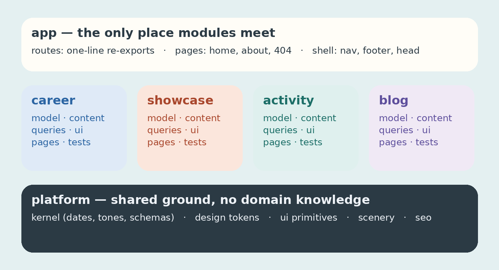

Let me start with the disclosure, because it's the point: I didn't write this website. I wrote
the first few commits, long ago, and almost nothing of them survives. Everything you can see and
everything underneath it — the sky, the hills, the starship landing in the hero, the colour
palette, the component code, the build, the tests, the blog you're reading, and the first draft
of this very post — was written by AI agents, over a long stretch of time, with me directing.

People usually mean something smaller by "built with AI": a function here, a regex there, a
snippet pasted from a chat. This is the other thing. A site where _all_ of the craft came out of
a conversation, and where my job was never to type.

## Starting from nothing

There was an empty repository and a description: who I am, what I work on, and how I wanted the
site to feel. Not a wireframe, not a mood board — sentences. Bright rather than dark. The sky as
the ground, content sitting on cloud-white panels, sunlight falling on the one thing that
matters on each page. Every page should walk from afternoon into dusk by the time you reach the
bottom. Rounded everything. No tracking, no cookies, nothing that needs a consent banner.

From that, the agent proposed a palette, a type pairing, the shapes. It came back with names:
`sky`, `panel`, `sun`, `wash`, `leaf`, three greens for the hills. Those words are still the
design tokens today, and the site's rule that nothing outside the palette may exist is enforced
by the stylesheet — `--color-*: initial`, then only what we named.

## The drawings are code

The part people find hardest to believe is the scenery. The hills along the bottom of every
header, the clouds drifting over the nav, the wind turbines turning at different speeds so they
never move in step, the train that comes out of a tunnel and crosses a viaduct, the satellite
orbiting my portrait, and the starship that falls from above the screen, flips, fires its landing
burn and is caught by the tower's arms — none of that is an image. It's SVG paths and CSS
keyframes, written by an agent from a description of what should happen.

```css
/*
  Starship falls from above the screen belly-first, then its landing burn slows it into the
  tower's arms. It rests there, relaunches and falls again for the next catch.
*/
@keyframes catch {
  from {
    translate: 0 -100svh;
    animation-timing-function: linear;
  }
  13.89% {
    translate: 0 -8vw;
    animation-timing-function: cubic-bezier(0.3, 0.7, 0.5, 1);
  }
  25% {
    translate: 0 -0.35vw;
    animation-timing-function: ease-in;
  }
  73% {
    translate: 0 0;
    animation-timing-function: cubic-bezier(0.55, 0, 0.9, 0.35);
  }
  87%,
  to {
    translate: 0 -100svh;
  }
}
```

What I contributed to that was words and judgement: the ship should turn belly-first again only
once it's out of sight; the tower's arms should stay open until the ship is between them; on a
phone, show it already caught, because the hero runs past the first screen there and the landing
would play out of sight. Each of those is now a comment in the code, next to the keyframe
percentages that make it true. I never edited a percentage.

## The code is what a careful engineer would write

I was worried, early on, that code written this way would be the kind you can't maintain: a
plausible pile. It isn't, and the reason is that every standard I'd hold a colleague to, I held
the agent to — in writing, as constraints it had to satisfy rather than suggestions it could
weigh.

- **Strict TypeScript**, every flag on. The content — jobs, projects, conferences, the tags on a
  post — is checked against schemas while the site builds. A mistyped date fails the build with
  the field named, not the page.
- **Static output.** Every page is rendered at build time. The site rebuilds itself every day so
  that "12 years of experience", "10 months at Resilio" and the "meet me at" conferences stay
  true without anyone touching them. A conference drops off the page the morning after it ends.
- **Accessibility and motion.** Every animation is behind `motion-safe:`. Tabs, menus and the
  skip link follow the patterns screen-reader users expect.
- **Architecture that stays legible.** The code is organised by subject, not by file type:
  one folder for everything about my career, one for projects, one for GitHub activity, one for
  this blog. Each owns its model, its content, its queries, its components and its page. The
  routes are one-line re-exports. A linter enforces that a folder can't reach into another.



None of that is novel. What's different is that I didn't implement any of it. I named it, and
then I read the result the way I'd read a pull request from someone I trust but verify.

## What a long time looks like

This wasn't one heroic session. It's the accumulation of many, each adding or reshaping a
piece: the hero and its scenery, the "three worlds" tabs on the Work page, a GitHub card that
reads my contribution calendar during the build, the whole-site restructure into modules, this
blog. Each sat inside the same loop.

| I do                                    | The agent does                                                                   |
| --------------------------------------- | -------------------------------------------------------------------------------- |
| Describe what should change, and why    | Reads the whole codebase first, then proposes — as findings, not code            |
| Set the constraints it can't trade away | Spikes anything risky in a throwaway copy before planning around it              |
| Decide between real options             | Works in small, reversible steps, one commit each                                |
| Read everything, and say no             | Proves each step: types, lint, tests, a full build, a diff of the rendered pages |
| Keep the decisions that can't be undone | Tells me what it couldn't verify and what it wouldn't decide                     |

The last two lines matter most. When there were two deployment configurations for one domain,
the agent wouldn't delete either, because it couldn't tell which one was live and the wrong
guess takes the site down. That's the right instinct, and it's the same one I'd want from a
person.

Two small stories from the most recent work, because they're the honest part:

> Lightning CSS silently emitted an empty `@keyframes live {}` when a `color-mix()` landed inside
> the keyframes. The pulsing dot next to "Open to collaborate" would have quietly stopped
> pulsing.

The agent caught that by reading the generated CSS, not because anything failed. And when it
introduced a bug of its own — passing a compiled post into a component the framework then
couldn't serialise — it found it the same way, ran the page, and fixed it before I saw it.
AI-written code has AI-found bugs. The loop catches them when the loop is strict.

## What I'm actually doing, then

Not typing. Not, mostly, even reading code first — reading findings, plans and diffs, and
looking at the rendered result on a laptop and on a phone. I supply taste ("the post title
should be one line, and the text should start on the first screen"), constraints ("no new
dependency unless the lockfile can be updated"), decisions ("stay on this framework; it was
verified to do what we need"), and the willingness to say "that's ugly, do better".

It's closer to being an editor than an author, and it's closer to being a staff engineer than I
expected: the work of deciding what good means here and refusing to ship less. The typing was
never the hard part. It turns out it wasn't the interesting part either.

## A last disclosure

This post was drafted by the same agent, from the history of the project, and edited by me. If
that makes you trust it less, I understand. If it makes you curious what the edit looked like —
that's the part that's mine.
